# Experiment 8: Oscillator and Multivibrator Circuits

EC3091D - Electronic Circuits Lab II | LM741 macromodel revision | 1 November 2026

Evidence status: 13 final LM741 macromodel trials were simulated. 12 pass circuit-behavior checks; one original-value bistable trial fails to switch. The 12-sheet fair-record PDF contains successful trials only. A separate failure sheet preserves the baseline result. These are manufacturer-attributed macromodel simulations, not physical hardware measurements or independent authentication against a current TI download.

## Aim

To design, set up and study a Wien-bridge oscillator and astable, monostable and bistable multivibrator circuits, and investigate frequency, pulse timing and state retention as resistor/capacitor values change.

## Apparatus and software

ngspice 44.2; Python 3.12 with NumPy 2.5.4, SciPy 1.18.1, Matplotlib 3.11.2 (Agg). Existing system Python provides ReportLab, python-docx and PyMuPDF for documents and checks. Every circuit uses +/-15 V supplies. No packages were installed. The existing circuit-lab checkout and cloud configuration were preserved.

## Source priority

All three pages of the original lab PDF were read and inspected as images before the earlier netlist implementation; those images are reproduced in the appendix. The uploaded reference report labels its waveforms theoretical illustrations. None of those illustrations is used as measured evidence. Uploaded ASC files are supplementary connection checks only. New measurements in this revision come exclusively from LM741 numerical transient data. Earlier educational-model results remain in the separate experiment-8 directory and are superseded for device-specific interpretation.

## Model source, license and provenance

The model is National Semiconductor LM741/NS, downloaded from drahnr/oregano at pinned revision 25919de7ec2cf3e5053d4a9497b31188d355d653, data/models/LM741.model. The original header attributes National Semiconductor copyright and explicitly permits copying and distribution while prohibiting resale. The complete notice is retained in models/LM741.model. Source URL, revision and compatibility changes are in models/PROVENANCE.txt. The manufacturer-hosted URL still returned a proxy CONNECT 403 in this runtime; the readable runtime policy still reported restricted/enforced. This successful acquisition used an accessible independent source, not an unrestricted-network assumption.

Subcircuit: .SUBCKT LM741/NS 1 2 99 50 28. External order is noninverting, inverting, positive supply, negative supply, output, corresponding to physical LM741 pins 3, 2, 7, 4, 6. Offset-null pins are not exposed. Each XU uses plus minus vp vn out LM741/NS. Supplies are +15 and -15 V. This is the actual LM741 macromodel, not a renamed EDU741 substitute.

# ngspice compatibility and model validation

Unmodified POLY-source parsing required an unavailable initialization of the retained polynomial code model. Explicitly loading the retained spice2poly.cm also crashed a separate exploratory process (exit 139); no package or environment configuration was changed. The working copy translates only two first-order sources algebraically: EOS 7 1 POLY(1) 16 49 1E-3 1 becomes BEOS 7 1 V=1e-3+v(16,49); F6 50 99 POLY(1) V6 450U 1 becomes BF6 50 99 I=450u+i(V6). Coefficients and all other model devices/values remain unchanged. The original and translated files are both bundled. QC verifies exactly those differences.

Independent bench: maximum follower error over -1 to +1 V is 1.026550 mV, consistent with this model's explicit 1 mV offset. Unloaded open-loop saturation is 14.027168 / -14.027168 V. A loaded follower step yields a fitted slew rate of 0.320543 V/us. The bench checks pin order, polarity, supply connections and finite response; it does not establish agreement with every LM741 datasheet limit or physical device.

Convergence: final netlists use Gear integration, reltol=1e-5 and abstol=1e-10. Wien initialization constrains plus to 50 mV during the initial operating point, then releases it; UIC was removed to initialize internal macromodel states consistently. Earlier UIC Wien trials aborted near t=0 even though ngspice returned 0. Final checks therefore inspect logs and require the last sample to reach the requested stop time. All 13 final transients reach that time. Known missing-spinit warnings are retained and do not supply any model devices used in the translated netlists.

## Original circuit connections

## Figure 1 - Wien bridge

RIN=1 kohm from inverting input to ground. RF=1.5 kohm + 510 ohm of a 1 kohm potentiometer, total 2.01 kohm, from output to inverting input. Gain=1+RF/RIN=3.01. Series R2-C2 connects output to noninverting input; R1 and C1 shunt noninverting input to ground. R1=R2=R and C1=C2=C. No amplitude-control component was added. Macromodel saturation limits amplitude and causes measurable distortion.

## Figure 2 - Astable

R1=10 kohm from noninverting input to ground, R2=10 kohm from output to noninverting input. Timing R connects output to inverting input; C shunts that node to ground. beta=R1/(R1+R2)=0.5. Initial capacitor voltage is 50 mV with UIC. Measurements exclude startup.

## Figure 3 - Monostable

R1=R2=10 kohm form an output-to-ground divider, midpoint to noninverting input. Timing R connects output to inverting input; C shunts to ground. D1 anode is at that capacitor node, cathode at ground. Cd=0.01 uF couples the trigger to Rd=470 ohm to ground. D2 anode is at the noninverting input and cathode at the differentiator node. Both assumed diodes use the explicitly listed generic 1N4148 model. Negative trigger edges initiate a LOW pulse; HIGH is stable.

## Figure 4 - Bistable

C couples the left trigger terminal to the INVERTING input; R shunts that node to ground. R1=R2=10 kohm form positive feedback, midpoint to the noninverting input. The +/-VT label denotes feedback threshold, not another source. Omitted supplies are taken as +/-15 V. A nodeset selects initial HIGH; it is a numerical state selection, not a physical set pulse.

# Theory and design equations

Wien: for equal R/C, bridge phase is zero and feedback=1/3 at f0=1/(2*pi*R*C). Required small-signal amplifier gain is 3. Gain 3.01 provides startup margin, while saturation supplies amplitude limiting in this unstabilized handout circuit. It is not a precision amplitude-regulated sine source. No square-wave duty cycle is assigned.

Astable: after switching HIGH, Vc=Vs-(1+beta)*Vs*exp(-t/RC). At Vc=beta*Vs, Ton=RC*ln[(1+beta)/(1-beta)]. Symmetrically Toff=Ton; T=2*RC*ln(3), f=1/T for beta=0.5. Finite switching and recovery cause departures from the instantaneous, symmetric voltage-source assumption.

Monostable: stable HIGH clamps Vc near VD. On switching to -VL, Vc=-VL+(VD+VL)*exp(-t/RC). At Vc=-beta*VL the output returns HIGH. Thus tw=RC*ln[(VL+VD)/(VL*(1-beta))]. Nominal calculation assumptions for this model: VL=13.9 V, VD=0.600 V, beta=0.5. The ideal zero-drop limit RC*ln(2) is also given. Nominal saturation and diode voltage are assumptions for theory, not substituted measurements. Compare the mean measured width against the corrected theoretical width.

Monostable trigger: 0 to -15 V, first at 10 ms, negative transition time 50 us, return time 1 us, LOW plateau 100 us, repetition period 20 ms (50 Hz). The 50 us ramp sustains the differentiated trigger sufficiently for the LM741 response. The earlier 0.2 us edge caused only a small output dip and did not trigger; that exploratory failure is preserved. Trigger rate is external, not an inherent oscillation frequency. Pulse duty is reported only relative to this trigger sequence.

Bistable: thresholds are approximately +/-beta*Vs, about +/-7 V. C and R form a high-pass input with decay constant RC. The output retains either state when the input has decayed to zero. Positive inverting-input edges reset LOW; negative edges set HIGH if the transient lasts long enough for the amplifier to respond. A return edge can switch again. There is no inherent period/frequency/duty.

Bistable trigger: source pulses 0 to +12 V at 1 ms, -12 V at 3 ms, +12 V at 5 ms, -12 V at 7 ms; each returns to zero after 0.2 ms; edge duration 0.2 us. With R=100 ohm and C=0.1 uF, RC=10 us: the input exceeds a roughly 7 V threshold for only about RC*ln(12/7)=5.4 us. The model cannot switch under that short drive. This failure is not hidden by changing the original baseline. Added trial 4 keeps R=100 ohm and increases C to 0.22 uF, producing a third successful bistable configuration.

## Simulation and measurement procedure

Source startup.sh in each fresh shell; generate netlists using trials.json; run ngspice batch; retain logs and actual samples; verify data reaches the stop time. Periodic measurements use the final 40% of each transient; monostable measurements exclude t<5 ms and average three triggered pulses. All output transitions use linearly interpolated 0 V crossings. Rising-to-rising yields mean T; f=1/mean(T). Ton is rising-to-next-falling; Toff=T-Ton; duty=100*Ton/T. LOW pulse width is falling-to-next-rising. Vmax/min are extrema in the analysis window. Plateau estimates use medians beyond 80% of the extrema. No smoothing or synthetic replacement is applied.

Wien amplitude stationarity compares peak-to-peak values in 60-80% and 80-100% windows and requires less than 1% change. Harmonics 2-5 are fitted by least squares over integer settled cycles to provide a distortion indicator. Bistable retention is sampled after the external pulse returns to zero. Failed switching is explicitly flagged even if a finite positive Vmin exists; that Vmin is not a demonstrated logic LOW.

Maximum-timestep halving on Wien 1, astable 1, monostable 1 and successful bistable 2: wien_01: 0.0017134% timing change, astable_01: 4.2467e-05% timing change, monostable_01: 0.00028525% timing change, bistable_02: 1.9752e-05% timing change. Raw reruns and logs are included.

# Observation tables

## Figure 1 - Wien

| Trial | R / C | Theory Hz | Sim Hz | T ms | Vpp V |
| --- | --- | --- | --- | --- | --- |
| 1 | 10000 ohm / 0.1 uF | 159.155 | 159.015 | 6.2887 | 27.586 |
| 2 | 1000 ohm / 0.22 uF | 723.432 | 720.890 | 1.3872 | 27.367 |
| 3 | 4700 ohm / 0.1 uF | 338.628 | 338.049 | 2.9582 | 27.556 |

## Figure 2 - Astable

| Trial / R | C uF | Ton ms | Toff ms | T ms | f Hz | Duty % |
| --- | --- | --- | --- | --- | --- | --- |
| 1 / 4700 ohm | 0.1 | 0.5723 | 0.5722 | 1.1444 | 873.788 | 50.005 |
| 2 / 10000 ohm | 0.1 | 1.1456 | 1.1453 | 2.2908 | 436.519 | 50.007 |
| 3 / 22000 ohm | 0.1 | 2.4258 | 2.4246 | 4.8505 | 206.166 | 50.013 |

## Figure 3 - Monostable

| Trial / R | C uF | Theory tw ms | Sim tw ms | Trigger Hz | Min / Max V |
| --- | --- | --- | --- | --- | --- |
| 1 / 15000 ohm | 0.1 | 1.1031 | 1.1422 | 50 | -13.929 / 13.888 |
| 2 / 22000 ohm | 0.1 | 1.6179 | 1.6365 | 50 | -13.936 / 13.899 |
| 3 / 33000 ohm | 0.1 | 2.4268 | 2.4044 | 50 | -13.942 / 13.907 |

## Figure 4 - Bistable

| Trial / R | C uF | Trigger | Initial / final | Behavior |
| --- | --- | --- | --- | --- |
| 1 / 100 ohm | 0.1 | +/-12 V | HIGH / HIGH | FAIL: no switch |
| 2 / 220 ohm | 0.1 | +/-12 V | HIGH / LOW | PASS |
| 3 / 470 ohm | 0.1 | +/-12 V | HIGH / LOW | PASS |
| 4 / 100 ohm | 0.22 | +/-12 V | HIGH / LOW | PASS |

Output levels for each bistable trial are listed on its calculation sheet. Baseline trial 1 does not demonstrate LOW; its positive minimum is a dip, not a second stable state. T, f, duty and frequency error are N/A for all bistable trials.

# Calculation sheet - wien_01

Behavior result: PASS (LM741 macromodel behavior)

Given: R=10000 ohm; C=0.1 uF = 1e-07 F; supplies +/-15 V.

R1=R2=R; C1=C2=C; RIN=1 kohm; RF=2.01 kohm = 1.5 kohm + 510 ohm potentiometer setting; gain=3.01.

f theory=1/[2*pi*(10000)*(1e-07)]=159.154943 Hz.

Measured mean T=6.288712 ms across 317 settled cycles; period SD=0.00369475 us. f sim=1/T=159.015065 Hz.

Error=|159.015065-159.154943|/159.154943*100=0.087888%.

Harmonic distortion indicator (2-5)=0.59619%; amplitude drift=0%. Startup seed: plus constrained to 50 mV for initial operating point, released during transient. Duty: N/A for this near-sinusoidal output. Model saturation supplies amplitude limiting; no AGC added.

Analysis-window extrema: Vmax=13.792995 V; Vmin=-13.792933 V; Vpp=Vmax-Vmin=27.585928 V. Data: simulation_data/wien_01.txt; netlist: circuits/wien/wien_01.cir. No theoretical waveform samples were substituted.

# Actual ngspice waveform - wien_01

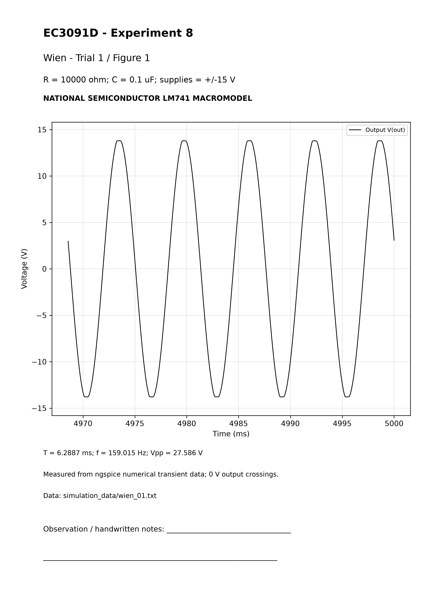

# Calculation sheet - wien_02

Behavior result: PASS (LM741 macromodel behavior)

Given: R=1000 ohm; C=0.22 uF = 2.2e-07 F; supplies +/-15 V.

R1=R2=R; C1=C2=C; RIN=1 kohm; RF=2.01 kohm = 1.5 kohm + 510 ohm potentiometer setting; gain=3.01.

f theory=1/[2*pi*(1000)*(2.2e-07)]=723.431560 Hz.

Measured mean T=1.387173 ms across 316 settled cycles; period SD=0.00142465 us. f sim=1/T=720.890441 Hz.

Error=|720.890441-723.431560|/723.431560*100=0.351259%.

Harmonic distortion indicator (2-5)=0.60286%; amplitude drift=0%. Startup seed: plus constrained to 50 mV for initial operating point, released during transient. Duty: N/A for this near-sinusoidal output. Model saturation supplies amplitude limiting; no AGC added.

Analysis-window extrema: Vmax=13.683676 V; Vmin=-13.683301 V; Vpp=Vmax-Vmin=27.366977 V. Data: simulation_data/wien_02.txt; netlist: circuits/wien/wien_02.cir. No theoretical waveform samples were substituted.

# Actual ngspice waveform - wien_02

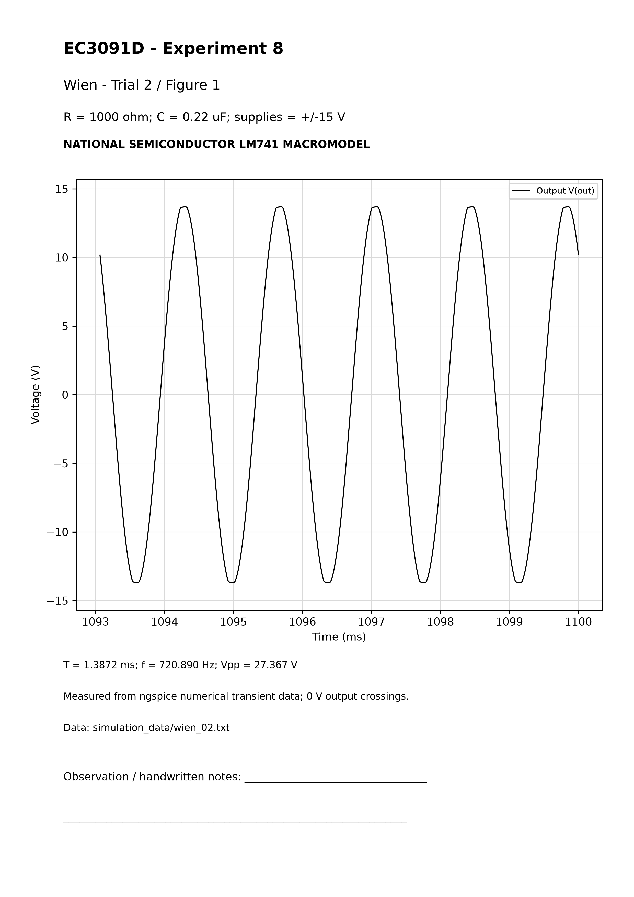

# Calculation sheet - wien_03

Behavior result: PASS (LM741 macromodel behavior)

Given: R=4700 ohm; C=0.1 uF = 1e-07 F; supplies +/-15 V.

R1=R2=R; C1=C2=C; RIN=1 kohm; RF=2.01 kohm = 1.5 kohm + 510 ohm potentiometer setting; gain=3.01.

f theory=1/[2*pi*(4700)*(1e-07)]=338.627538 Hz.

Measured mean T=2.958154 ms across 316 settled cycles; period SD=0.00272842 us. f sim=1/T=338.048620 Hz.

Error=|338.048620-338.627538|/338.627538*100=0.170960%.

Harmonic distortion indicator (2-5)=0.59797%; amplitude drift=0%. Startup seed: plus constrained to 50 mV for initial operating point, released during transient. Duty: N/A for this near-sinusoidal output. Model saturation supplies amplitude limiting; no AGC added.

Analysis-window extrema: Vmax=13.778256 V; Vmin=-13.778127 V; Vpp=Vmax-Vmin=27.556383 V. Data: simulation_data/wien_03.txt; netlist: circuits/wien/wien_03.cir. No theoretical waveform samples were substituted.

# Actual ngspice waveform - wien_03

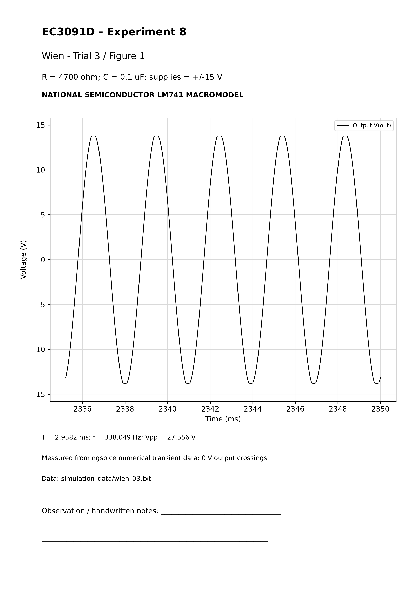

# Calculation sheet - astable_01

Behavior result: PASS (LM741 macromodel behavior)

Given: R=4700 ohm; C=0.1 uF = 1e-07 F; supplies +/-15 V.

R1=R2=10 kohm; beta=0.5. Ton ideal=Toff ideal=R*C*ln(3)=0.516348 ms. T ideal=2*(4700)*(1e-07)*ln(3); f theory=968.339603 Hz.

Measured mean T=1.144443 ms across 8 settled cycles; period SD=0.000204538 us. f sim=1/T=873.787788 Hz.

Error=|873.787788-968.339603|/968.339603*100=9.764324%.

Ton=0.572278 ms; Toff=0.572165 ms; T=Ton+Toff. Duty=100*Ton/T=50.004927%. Plateau HIGH/LOW=13.847112/-13.849260 V.

Analysis-window extrema: Vmax=13.886806 V; Vmin=-13.886798 V; Vpp=Vmax-Vmin=27.773604 V. Data: simulation_data/astable_01.txt; netlist: circuits/astable/astable_01.cir. No theoretical waveform samples were substituted.

# Actual ngspice waveform - astable_01

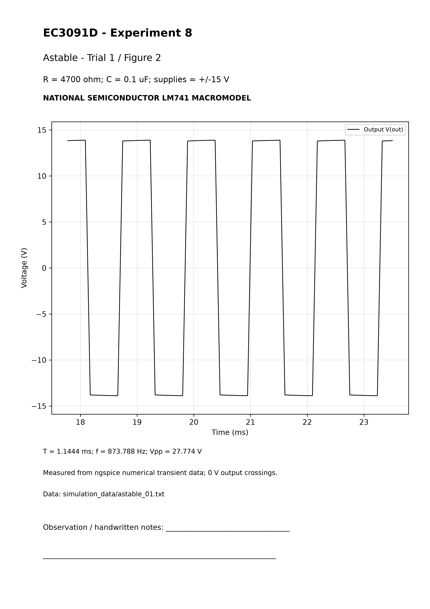

# Calculation sheet - astable_02

Behavior result: PASS (LM741 macromodel behavior)

Given: R=10000 ohm; C=0.1 uF = 1e-07 F; supplies +/-15 V.

R1=R2=10 kohm; beta=0.5. Ton ideal=Toff ideal=R*C*ln(3)=1.098612 ms. T ideal=2*(10000)*(1e-07)*ln(3); f theory=455.119613 Hz.

Measured mean T=2.290850 ms across 8 settled cycles; period SD=0.000219266 us. f sim=1/T=436.519256 Hz.

Error=|436.519256-455.119613|/455.119613*100=4.086916%.

Ton=1.145592 ms; Toff=1.145257 ms; T=Ton+Toff. Duty=100*Ton/T=50.007310%. Plateau HIGH/LOW=13.897324/-13.898603 V.

Analysis-window extrema: Vmax=13.918282 V; Vmin=-13.918278 V; Vpp=Vmax-Vmin=27.836560 V. Data: simulation_data/astable_02.txt; netlist: circuits/astable/astable_02.cir. No theoretical waveform samples were substituted.

# Actual ngspice waveform - astable_02

# Calculation sheet - astable_03

Behavior result: PASS (LM741 macromodel behavior)

Given: R=22000 ohm; C=0.1 uF = 1e-07 F; supplies +/-15 V.

R1=R2=10 kohm; beta=0.5. Ton ideal=Toff ideal=R*C*ln(3)=2.416947 ms. T ideal=2*(22000)*(1e-07)*ln(3); f theory=206.872552 Hz.

Measured mean T=4.850462 ms across 8 settled cycles; period SD=0.000827076 us. f sim=1/T=206.165925 Hz.

Error=|206.165925-206.872552|/206.872552*100=0.341576%.

Ton=2.425839 ms; Toff=2.424623 ms; T=Ton+Toff. Duty=100*Ton/T=50.012537%. Plateau HIGH/LOW=13.925361/-13.925135 V.

Analysis-window extrema: Vmax=13.936210 V; Vmin=-13.936210 V; Vpp=Vmax-Vmin=27.872420 V. Data: simulation_data/astable_03.txt; netlist: circuits/astable/astable_03.cir. No theoretical waveform samples were substituted.

# Actual ngspice waveform - astable_03

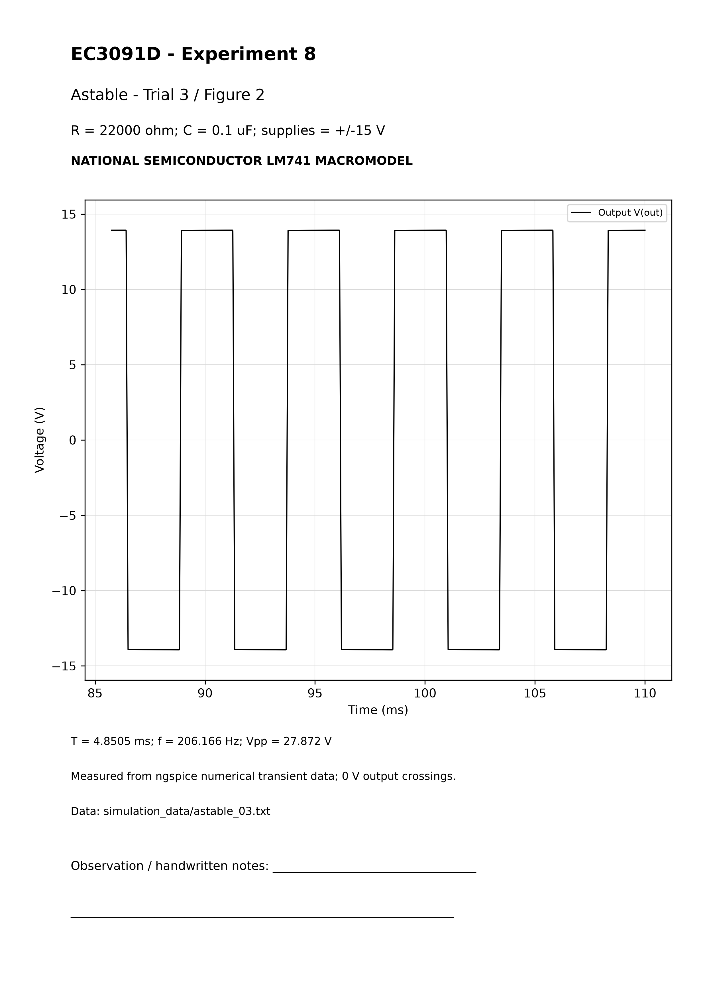

# Calculation sheet - monostable_01

Behavior result: PASS (LM741 macromodel behavior)

Given: R=15000 ohm; C=0.1 uF = 1e-07 F; supplies +/-15 V.

R1=R2=10 kohm, Rd=470 ohm, Cd=0.01 uF; beta=0.5. HIGH is stable, LOW quasi-stable. Nominal theory assumes VL=13.9 V and VD=0.6 V.

tw theory=(15000)*(1e-07)*ln[(13.9+0.6)/(13.9*(1-0.5))]=1.103110 ms. Ideal zero-drop limit RC*ln(2)=1.039721 ms.

Measured width=1.142205 ms, three pulses; SD=0.000446546 us. Width error=|1.142205-1.103110|/1.103110*100=3.544055%.

External trigger T=20 ms; trigger f=50 Hz. Output duty relative to this sequence=5.71103%. Plateau HIGH/LOW=13.888471/-13.919014 V. Startup pulse is excluded; only triggered events near 10, 30 and 50 ms are averaged. No free-running frequency is assigned.

Analysis-window extrema: Vmax=13.888471 V; Vmin=-13.928913 V; Vpp=Vmax-Vmin=27.817383 V. Data: simulation_data/monostable_01.txt; netlist: circuits/monostable/monostable_01.cir. No theoretical waveform samples were substituted.

# Actual ngspice waveform - monostable_01

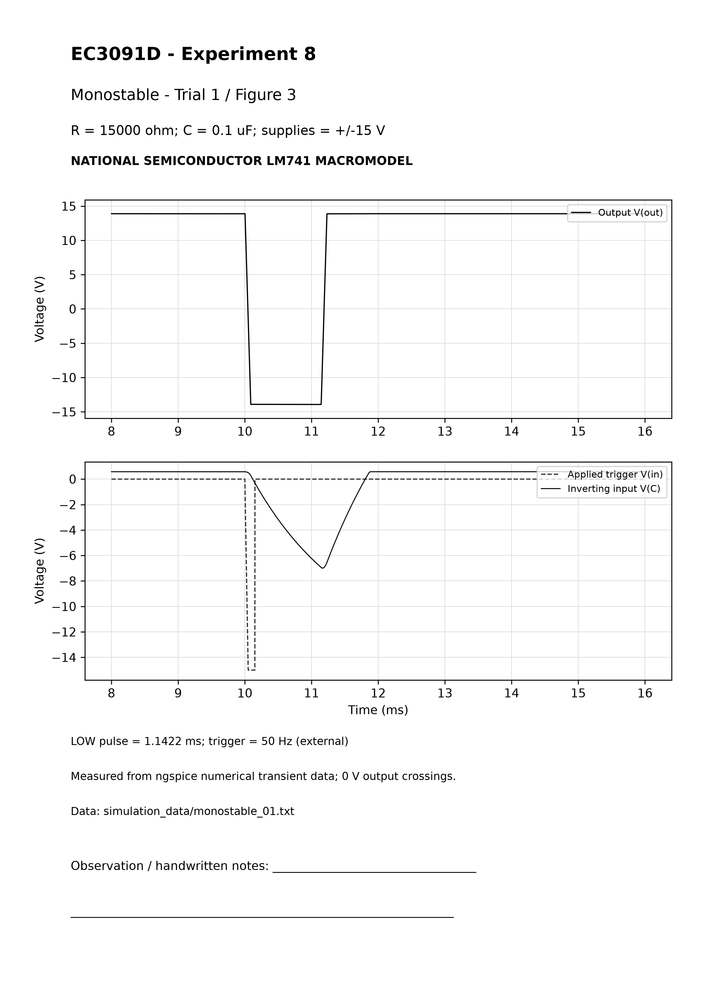

# Calculation sheet - monostable_02

Behavior result: PASS (LM741 macromodel behavior)

Given: R=22000 ohm; C=0.1 uF = 1e-07 F; supplies +/-15 V.

R1=R2=10 kohm, Rd=470 ohm, Cd=0.01 uF; beta=0.5. HIGH is stable, LOW quasi-stable. Nominal theory assumes VL=13.9 V and VD=0.6 V.

tw theory=(22000)*(1e-07)*ln[(13.9+0.6)/(13.9*(1-0.5))]=1.617895 ms. Ideal zero-drop limit RC*ln(2)=1.524924 ms.

Measured width=1.636525 ms, three pulses; SD=7.66383e-05 us. Width error=|1.636525-1.617895|/1.617895*100=1.151458%.

External trigger T=20 ms; trigger f=50 Hz. Output duty relative to this sequence=8.18262%. Plateau HIGH/LOW=13.899050/-13.929174 V. Startup pulse is excluded; only triggered events near 10, 30 and 50 ms are averaged. No free-running frequency is assigned.

Analysis-window extrema: Vmax=13.899050 V; Vmin=-13.936210 V; Vpp=Vmax-Vmin=27.835260 V. Data: simulation_data/monostable_02.txt; netlist: circuits/monostable/monostable_02.cir. No theoretical waveform samples were substituted.

# Actual ngspice waveform - monostable_02

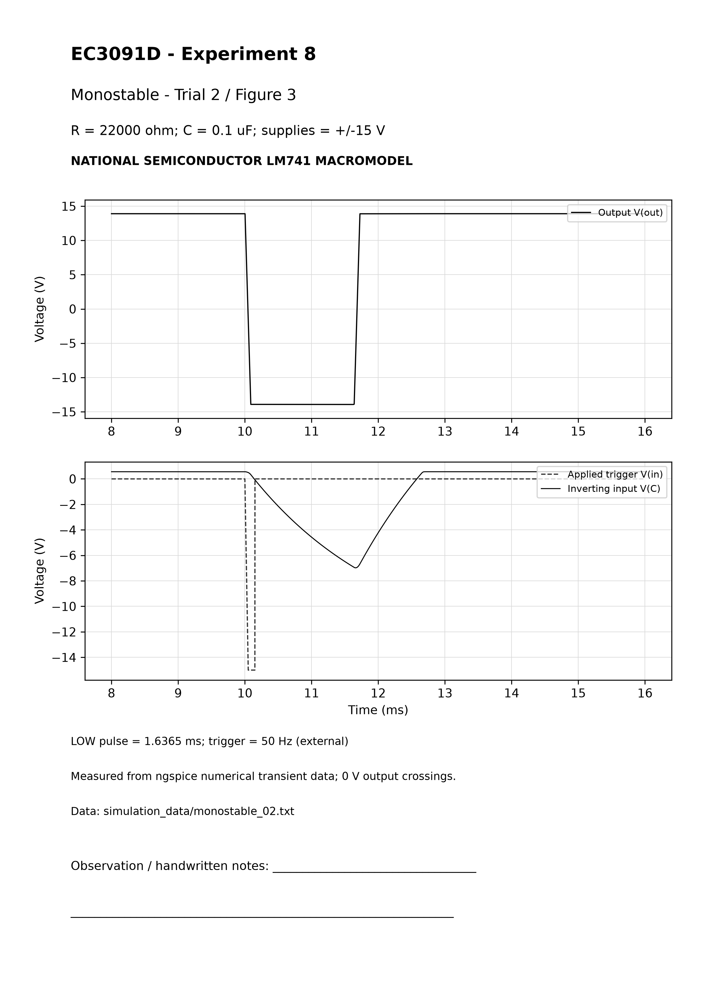

# Calculation sheet - monostable_03

Behavior result: PASS (LM741 macromodel behavior)

Given: R=33000 ohm; C=0.1 uF = 1e-07 F; supplies +/-15 V.

R1=R2=10 kohm, Rd=470 ohm, Cd=0.01 uF; beta=0.5. HIGH is stable, LOW quasi-stable. Nominal theory assumes VL=13.9 V and VD=0.6 V.

tw theory=(33000)*(1e-07)*ln[(13.9+0.6)/(13.9*(1-0.5))]=2.426843 ms. Ideal zero-drop limit RC*ln(2)=2.287386 ms.

Measured width=2.404417 ms, three pulses; SD=0.00019928 us. Width error=|2.404417-2.426843|/2.426843*100=0.924064%.

External trigger T=20 ms; trigger f=50 Hz. Output duty relative to this sequence=12.02209%. Plateau HIGH/LOW=13.906968/-13.936859 V. Startup pulse is excluded; only triggered events near 10, 30 and 50 ms are averaged. No free-running frequency is assigned.

Analysis-window extrema: Vmax=13.906968 V; Vmin=-13.941758 V; Vpp=Vmax-Vmin=27.848726 V. Data: simulation_data/monostable_03.txt; netlist: circuits/monostable/monostable_03.cir. No theoretical waveform samples were substituted.

# Actual ngspice waveform - monostable_03

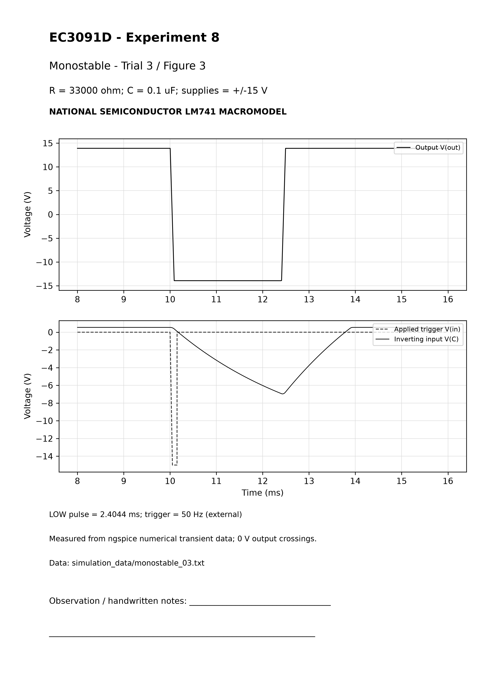

# Calculation sheet - bistable_01

Behavior result: FAIL: no demonstrated bistable switching

Given: R=100 ohm; C=0.1 uF = 1e-07 F; supplies +/-15 V.

R1=R2=10 kohm; beta=0.5. RC=(100)*(1e-07)=10.000 us, a trigger decay constant, not period. Approximate positive threshold beta*Vmax=6.977079 V.

Output 0 V switch times (ms): NONE - failed to switch

Retained output medians (V) in quiet windows 0.2-0.8, 1.5-2.8, 3.5-4.8, 5.5-6.8, 7.5-8.8 ms: 13.953638, 13.953638, 13.953638, 13.953638, 13.953638

Failure explanation: 12 V / 0.2 us trigger edges decay through R*C before LM741 output changes state; no topology change made. No output LOW or successful latch transition is claimed. Extra trial 4 varies C to 0.22 uF; it does not replace the original baseline observation.

Initial HIGH; final HIGH. Inherent frequency, period, duty and frequency-error calculation: N/A. Return edges of the AC-coupled trigger may also switch the latch.

Analysis-window extrema: Vmax=13.954159 V; Vmin=11.624571 V; Vpp=Vmax-Vmin=2.329588 V. Data: simulation_data/bistable_01.txt; netlist: circuits/bistable/bistable_01.cir. No theoretical waveform samples were substituted.

# Actual ngspice waveform - bistable_01

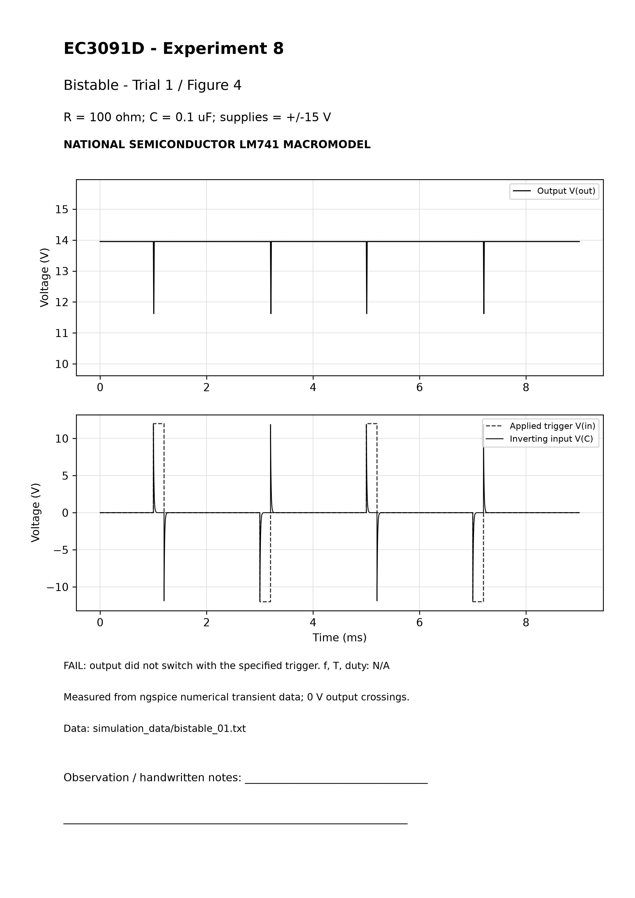

# Calculation sheet - bistable_02

Behavior result: PASS (LM741 macromodel behavior)

Given: R=220 ohm; C=0.1 uF = 1e-07 F; supplies +/-15 V.

R1=R2=10 kohm; beta=0.5. RC=(220)*(1e-07)=22.000 us, a trigger decay constant, not period. Approximate positive threshold beta*Vmax=6.977048 V.

Output 0 V switch times (ms): 1.043258, 1.243258, 3.243258, 5.243258, 7.243258

Retained output medians (V) in quiet windows 0.2-0.8, 1.5-2.8, 3.5-4.8, 5.5-6.8, 7.5-8.8 ms: 13.953639, 13.953639, -13.953642, 13.953639, -13.953642

Initial HIGH; final LOW. Inherent frequency, period, duty and frequency-error calculation: N/A. Return edges of the AC-coupled trigger may also switch the latch.

Analysis-window extrema: Vmax=13.954097 V; Vmin=-13.954100 V; Vpp=Vmax-Vmin=27.908197 V. Data: simulation_data/bistable_02.txt; netlist: circuits/bistable/bistable_02.cir. No theoretical waveform samples were substituted.

# Actual ngspice waveform - bistable_02

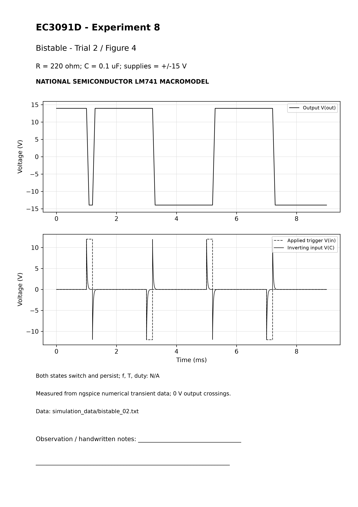

# Calculation sheet - bistable_03

Behavior result: PASS (LM741 macromodel behavior)

Given: R=470 ohm; C=0.1 uF = 1e-07 F; supplies +/-15 V.

R1=R2=10 kohm; beta=0.5. RC=(470)*(1e-07)=47.000 us, a trigger decay constant, not period. Approximate positive threshold beta*Vmax=6.977049 V.

Output 0 V switch times (ms): 1.043260, 1.243262, 3.243262, 5.243262, 7.243262

Retained output medians (V) in quiet windows 0.2-0.8, 1.5-2.8, 3.5-4.8, 5.5-6.8, 7.5-8.8 ms: 13.953639, 13.953639, -13.953642, 13.953639, -13.953642

Initial HIGH; final LOW. Inherent frequency, period, duty and frequency-error calculation: N/A. Return edges of the AC-coupled trigger may also switch the latch.

Analysis-window extrema: Vmax=13.954097 V; Vmin=-13.954100 V; Vpp=Vmax-Vmin=27.908197 V. Data: simulation_data/bistable_03.txt; netlist: circuits/bistable/bistable_03.cir. No theoretical waveform samples were substituted.

# Actual ngspice waveform - bistable_03

# Calculation sheet - bistable_04

Behavior result: PASS (LM741 macromodel behavior)

Given: R=100 ohm; C=0.22 uF = 2.2e-07 F; supplies +/-15 V.

R1=R2=10 kohm; beta=0.5. RC=(100)*(2.2e-07)=22.000 us, a trigger decay constant, not period. Approximate positive threshold beta*Vmax=6.977048 V.

Output 0 V switch times (ms): 1.043258, 1.243258, 3.243258, 5.243258, 7.243258

Retained output medians (V) in quiet windows 0.2-0.8, 1.5-2.8, 3.5-4.8, 5.5-6.8, 7.5-8.8 ms: 13.953638, 13.953638, -13.953642, 13.953638, -13.953642

Initial HIGH; final LOW. Inherent frequency, period, duty and frequency-error calculation: N/A. Return edges of the AC-coupled trigger may also switch the latch.

Analysis-window extrema: Vmax=13.954097 V; Vmin=-13.954100 V; Vpp=Vmax-Vmin=27.908197 V. Data: simulation_data/bistable_04.txt; netlist: circuits/bistable/bistable_04.cir. No theoretical waveform samples were substituted.

# Actual ngspice waveform - bistable_04

# Results and discussion

12 of 13 final LM741 macromodel behavior trials pass. All final transients reach their requested stop time. Each of the four circuit types has three successful component configurations; the original-value bistable trial is additionally retained as a failed fourth observation for that circuit.

Wien frequency scales approximately as 1/(RC), and all three outputs settle with harmonic distortion about 0.6%. Amplitude is limited by output saturation; the handout lacks a lamp, diode gain control or AGC. Frequencies and amplitudes should not be interpreted as guaranteed component tolerances or hardware specifications.

Astable timing depends on both RC and switching dynamics; at the smallest RC, LM741 response contributes a substantial fraction of period. Thus the ideal symmetric relaxation formula is less accurate for the fastest trial. The monostable correctly returns to HIGH after a single LOW pulse, with width increasing with R. Its 50 Hz trigger frequency is external. Pulse-width theory assumes fixed saturation and diode voltage, whereas the actual diode and output stage are nonlinear.

Bistable trial 1 exposes a real bandwidth/slew limitation for the chosen trigger: RC=10 us is too short to induce a state change. Trials 2 and 3 increase R, and added trial 4 increases C while retaining R=100 ohm. These demonstrate persistent HIGH and LOW after trigger return. Changing coupling components is a documented trial variation, not a hidden modification to the original baseline.

## Conclusion

The earlier missing-LM741-model blocker is resolved: the working model is an accessible, licensed-for-copying, manufacturer-attributed LM741 macromodel with documented compatibility translation and validation. The study now provides 12 successful device-specific simulation trials and one honest baseline failure. The remaining limitation is that baseline bistable configuration under the stated trigger does not switch. No hardware measurement or current-manufacturer-release authentication is claimed.

## Fair record

Print Experiment_8_Waveform_Printouts.pdf: 12 A4 grayscale sheets. Pages 1-3 Wien trials 1-3; 4-6 astable 1-3; 7-9 monostable 1-3; 10-12 bistable 2-4. The failed original bistable trial is separately printable as Bistable_Baseline_Failure.pdf and should be discussed rather than omitted from the rough record. Retain component labels, source/model labels and measured captions.

## Rough record

Copy aim, apparatus, concise theory, original Figures 1-4, fixed/varied values, calculations with substitutions and units, procedure, the four observation tables, comparison, results, discussion and conclusion. Include the baseline failure and trigger edge change. Mark bistable autonomous timing N/A. Keep trigger frequency distinct from monostable pulse width.

See instructions/Beginner_Guide.md for exact run and plotting commands, editing trials.json and record preparation. No installation, worktree creation, commit, push or cloud configuration change was performed. SHA256SUMS.txt and QC.json provide final file checks. The earlier supplementary package is preserved separately.

# Original laboratory PDF - page 1

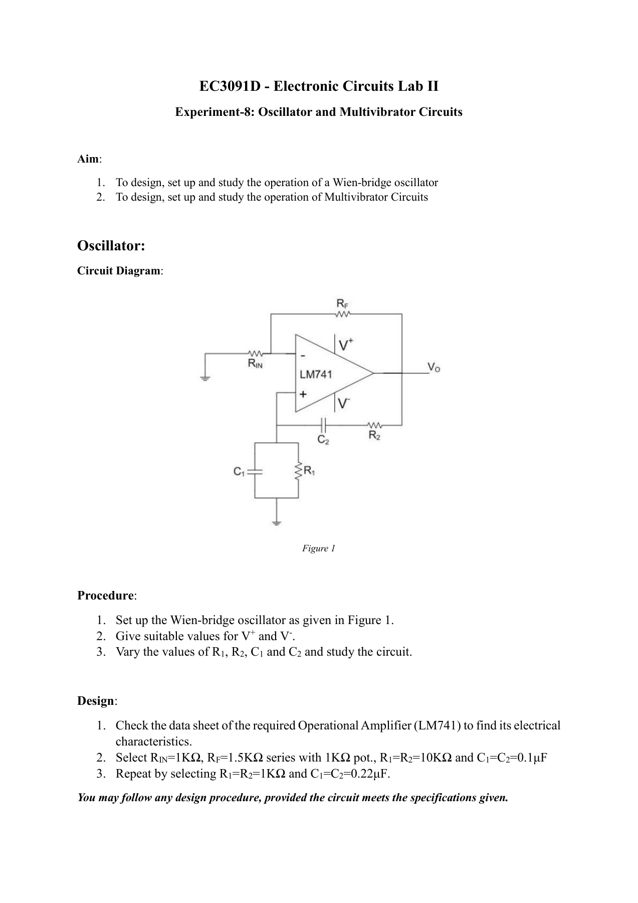

# Original laboratory PDF - page 2

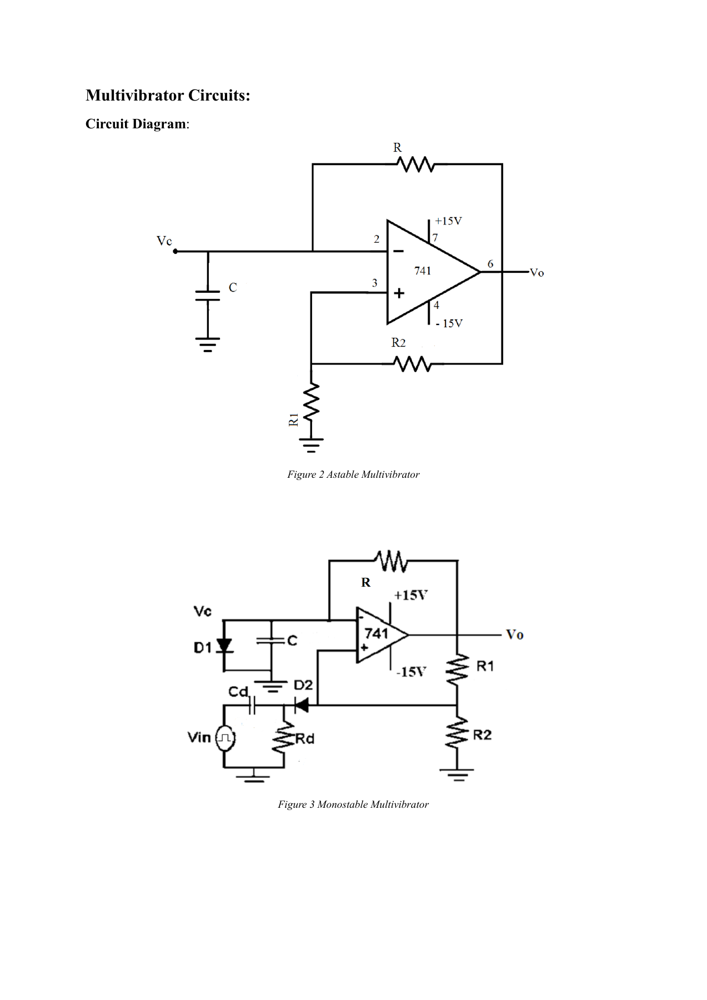

# Original laboratory PDF - page 3

